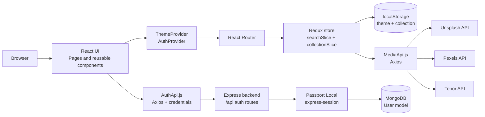

# ImageFinder

> Search, preview, and save photos, videos, and GIFs from multiple media providers.

ImageFinder is a React and Vite media-discovery application. Users can search across photos, videos, and GIFs, preview results in a responsive grid, save items to a local collection, switch themes, and use the included account registration and session-login flow.

## Live Demo and Repository

- **Live demo:** `https://find-image-two.vercel.app/`
- **Repository:** `https://github.com/brijesh23-dev/findImage`

## Screenshots

The following paths are placeholders for screenshots to add to the repository:


## Key Features

- Search photos through Unsplash.
- Search videos through Pexels.
- Search GIFs through Tenor.
- Switch between Photos, Videos, and GIFs result tabs.
- Preview photos and GIFs as linked media and videos with native playback controls.
- Save results to a browser-persisted collection and remove saved items.
- Persist the selected light/dark theme in `localStorage`.
- Register, log in, inspect the current session, and log out through the Express backend.
- Show loading shimmer, empty-result, retry, API-error, authentication-error, and unexpected-error states.
- Responsive navigation and result layouts built with Tailwind CSS.
- Render a fallback 404 page for unknown client-side routes.

## Technology Stack

| Area | Technologies used |
| --- | --- |
| Frontend | React, JavaScript ES6+, Vite, React Router |
| State management | Redux Toolkit, React-Redux |
| Styling and UI | Tailwind CSS, `@tailwindcss/vite`, React Icons, React Hot Toast |
| HTTP and media APIs | Axios, Unsplash REST API, Pexels REST API, Tenor REST API |
| Frontend behavior | Browser `localStorage`, React Context, responsive CSS |
| Backend | Node.js, Express, CORS, Morgan |
| Authentication | Passport Local Strategy, `express-session`, cookie-based sessions, bcrypt |
| Persistence | MongoDB through Mongoose |

## Architecture Overview

The frontend owns search presentation and client-side collection state. Search requests go directly from the browser to the configured media providers. Authentication requests go to the Express API, which uses Passport sessions and MongoDB for user persistence. Saved media is stored in the browser rather than in MongoDB.



`ProtectedRoute` is implemented, but the wrappers around `/` and `/collection` are currently commented out in `frontend/src/App.jsx`. The backend still exposes session authentication, and the client performs a profile check through `AuthProvider`.

## Project Structure

The tree below reflects the current repository and excludes generated `dist` and dependency `node_modules` directories.

```text
Image-gallery/
├── PRODUCT.md
├── README.md
├── backend/
│   ├── .env.example
│   ├── package.json
│   ├── server.js
│   └── src/
│       ├── app.js
│       ├── config/
│       │   ├── db.js
│       │   └── passport.js
│       ├── controller/
│       │   └── auth.controller.js
│       ├── model/
│       │   └── user.model.js
│       └── routes/
│           └── auth.routes.js
└── frontend/
    ├── .env.example
    ├── eslint.config.js
    ├── index.html
    ├── package.json
    ├── tailwind.config.js
    ├── vite.config.js
    ├── public/
    │   └── vite.svg
    └── src/
        ├── App.jsx
        ├── index.css
        ├── main.jsx
        ├── api/
        │   ├── AuthApi.js
        │   └── MediaApi.js
        ├── app/
        │   └── store.js
        ├── assets/
        │   └── react.svg
        ├── components/
        │   ├── AppErrorBoundary.jsx
        │   ├── AuthFormFields.jsx
        │   ├── CollectionCard.jsx
        │   ├── ErrorState.jsx
        │   ├── LoginForm.jsx
        │   ├── LogoutButton.jsx
        │   ├── ProtectedRoute.jsx
        │   ├── ResultCard.jsx
        │   ├── ResultGrid.jsx
        │   ├── ResultGridShimmer.jsx
        │   ├── SearchBox.jsx
        │   ├── SignupForm.jsx
        │   └── Tabs.jsx
        ├── context/
        │   ├── AuthContext.js
        │   ├── AuthProvider.jsx
        │   ├── ThemeProvider.jsx
        │   └── useAuth.js
        ├── features/
        │   ├── collectionSlice.js
        │   └── searchSlice.js
        ├── hook/
        │   └── ThemeHook.jsx
        └── pages/
            ├── CollectionPage.jsx
            ├── Homepage.jsx
            ├── LoginPage.jsx
            └── NotFoundPage.jsx
```

## How the Application Works

1. `main.jsx` mounts the app with `ThemeProvider`, the Redux `Provider`, and `BrowserRouter`.
2. The home page stores the submitted search text in `searchSlice`.
3. Selecting a media tab sets the active provider category.
4. `ResultGrid` calls the matching function in `MediaApi.js`, normalizes provider-specific responses into a shared result shape, and renders cards.
5. Loading, empty, and failed requests receive dedicated UI states; failed requests can be retried.
6. Saving a result dispatches `addCollection`. The collection slice prevents duplicate IDs and serializes the collection to `localStorage`.
7. The collection page reads the saved items from Redux and supports removal or clearing during logout.
8. Login and registration call `/api/login` and `/api/register` with credentials. The backend creates a session, and `AuthProvider` verifies it with `/api/profile`.
9. Logout calls `/api/logout`, clears client authentication, search state, and collection state, then navigates to `/login`.

## Installation and Setup

### Prerequisites

- Node.js and npm
- MongoDB, running locally or available through a connection URI
- API keys for Unsplash, Pexels, and Tenor

### 1. Configure the backend

```powershell
cd backend
npm install
```

Create `backend/.env` using the variables listed below. Start the server with the declared development script:

```powershell
npm run dev
```

The script invokes `nodemon server.js`. `nodemon` is referenced by the script but is not declared in `backend/package.json`; if it is not available in your environment, run the server directly:

```powershell
node server.js
```

### 2. Configure the frontend

```powershell
cd frontend
npm install
```

Create `frontend/.env` with the media provider keys and the backend base URL. Then start Vite:

```powershell
npm run dev
```

Open the local URL printed by Vite, normally `http://localhost:5173`.

## Environment Variables

### Frontend

These names are read by the frontend source:

| Variable | Description |
| --- | --- |
| `VITE_UNSPLASH_KEY` | Unsplash access key used in the `Client-ID` request header. |
| `VITE_PEXEL_KEY` | Pexels API key used in the `Authorization` request header. |
| `VITE_TENOR_KEY` | Tenor API key sent with GIF search requests. |
| `VITE_CLIENT_KEY` | Backend origin used by `AuthApi.js`; `/api` is appended by the client. |

Example:

```dotenv
VITE_UNSPLASH_KEY=your_unsplash_key
VITE_PEXEL_KEY=your_pexels_key
VITE_TENOR_KEY=your_tenor_key
VITE_CLIENT_KEY=http://localhost:3000
```

Vite exposes every variable prefixed with `VITE_` in client-side code. Do not treat these values as server-side secrets; use provider keys according to each provider's client-side usage and quota rules.

### Backend

These names are read by the backend source:

| Variable | Description |
| --- | --- |
| `MONGO_URI` | MongoDB connection string used by Mongoose. |
| `PORT` | Port for the Express server. The server code falls back to `5000` when unset. |
| `FRONTEND_ORIGINS` | Comma-separated frontend origins allowed by CORS for credentialed requests. |
| `NODE_ENV` | Controls production cookie behavior and proxy trust settings. |

Example:

```dotenv
MONGO_URI=mongodb://localhost:27017/image_finder
PORT=3000
FRONTEND_ORIGINS=http://localhost:5173,http://127.0.0.1:5173
NODE_ENV=development
```

Never commit `.env` files or real API keys. The checked-in environment example files do not currently list every variable consumed by the application, so use the tables above as the source of truth.

## Available npm Scripts

### Frontend (`frontend/`)

| Command | Purpose |
| --- | --- |
| `npm run dev` | Start the Vite development server with hot module replacement. |
| `npm run build` | Create a production build. |
| `npm run preview` | Preview the production build locally. |
| `npm run lint` | Run ESLint. |

### Backend (`backend/`)

| Command | Purpose |
| --- | --- |
| `npm run dev` | Start `server.js` through Nodemon. |
| `npm test` | Currently exits with “Error: no test specified”; automated backend tests are not configured. |

## Important Technical Implementations

- **Provider normalization:** `ResultGrid` converts Unsplash, Pexels, and Tenor responses into a common result format containing fields such as `id`, `type`, `title`, `thumbnail`, `src`, and `url`.
- **Redux state separation:** `searchSlice` owns query, active tab, results, loading, and error state; `collectionSlice` owns saved media.
- **Collection persistence:** The collection is initialized from `localStorage`, deduplicated by media ID, and updated after add/remove/clear actions.
- **Session authentication:** Express sessions and Passport Local serialize the user ID into the session; passwords are hashed with bcrypt and excluded from normal user queries.
- **Credentialed requests:** `AuthApi.js` uses Axios with `withCredentials: true` so the browser sends the session cookie.
- **Theme persistence:** `ThemeProvider` uses the saved theme or the system preference and toggles the `dark` class on the document root.
- **Failure handling:** API helpers translate provider errors, rate limits, authentication failures, and network failures into user-facing messages.
- **Error boundaries and feedback:** An application error boundary, retryable API error state, loading shimmer, and toast notifications provide feedback for common failure and save/remove actions.

## Future Improvements

- Enable `ProtectedRoute` for the home and collection routes, then verify redirects and return-path behavior.
- Align `frontend/.env.example` and `backend/.env.example` with all variables used by source code.
- Replace the hard-coded session secret with a dedicated environment variable and use a production session store.
- Add automated frontend and backend tests for provider mapping, authentication, collection persistence, and route protection.
- Add pagination or infinite scrolling for media results.
- Move media-provider requests behind a server-side proxy if provider-key protection is required.
- Add a persistent server-side collection associated with the authenticated user.
- Replace the default Vite favicon and update the document title to the final product branding.
- Add request cancellation and stronger stale-response handling for rapidly changing searches.

## Contributing

1. Create a feature branch from the default branch.
2. Keep frontend and backend changes scoped to the behavior being changed.
3. Do not commit `.env` files, API keys, or generated build output.
4. Run `npm run lint` and `npm run build` from `frontend/` before opening a pull request.
5. Describe the user-visible change, setup requirements, and validation performed in the pull request.

## License

No license file or finalized license declaration is currently present in the repository. Add a license before distributing the project publicly: `[Choose and add a license, for example MIT]`.

## Author

- **Name:** `Brijesh Rajbhar`
- **GitHub:** `https://github.com/brijesh23-dev`
- **LinkedIn:** `https://www.linkedin.com/in/brijesh-rajbhar-2b017432b/`
- **Portfolio:** `https://portfoliofullstack-two.vercel.app/`
